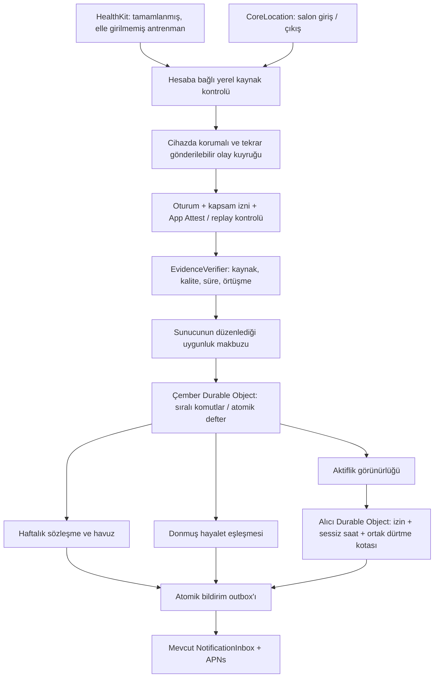
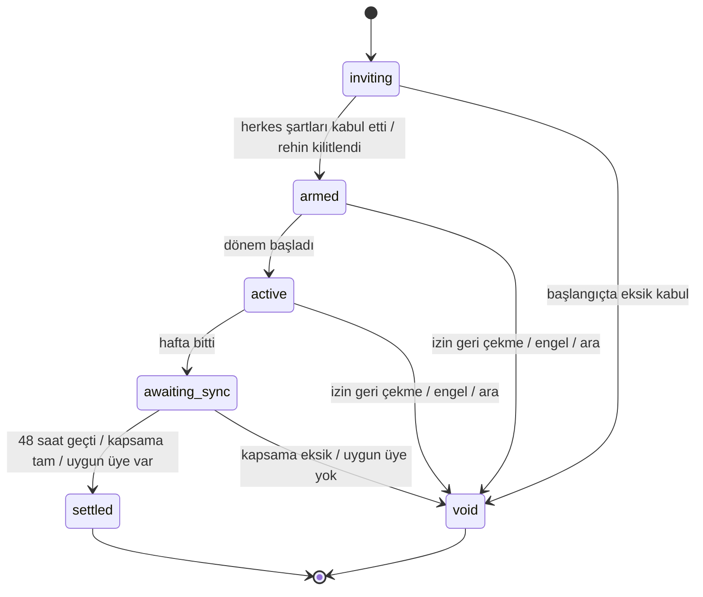

# Tempo Çember — pasif sosyal rekabet ve sorumluluk mimarisi

Bu belge üç mekanizmanın hedef ürün, iOS, sunucu, veri ve teslimat sözleşmesidir. Çalıştırılabilir saf kurallar `worker/src/passive-social-core.js` içindedir. İlk TestFlight bağlantıları artık `passive-social-live.js` ve `TempoCircle.swift` ile uygulanır. Hedef mimari ile beta sürümünün farkları, özellikle cihaz-beyanı güven seviyesi ve canlı Watch yüzeyinin kapsam dışında kalması, [TestFlight notunda](passive-social-testflight.md) belirtilir. Bir tasarım/test sonucu fiziksel cihaz doğrulaması olarak sunulmaz.

## Ürün

Sosyal bölümün yeni odağı **Çember**: 3–6 kişinin kapalı grubu, haftalık ortak ritim ve asenkron karşılaşmalar. Fotoğraf, gönderi, beğeni, yorum, takipçi, herkese açık sıralama ve durum yazısı yoktur. Mevcut arkadaş ekleme, çıkarma, engelleme, raporlama ve özel yarışlar korunabilir; yeni bölüm bu araçların üzerinde bir katmandır.

Sıfır veri girişi, sıfır izin anlamına gelmez. Kullanıcı yalnız ilk kurulumda gruba katılır, görünürlüğü ve bildirimleri seçer; her yeni sözleşmenin şartlarını kabul eder. Spor sırasında telefonla etkileşmez. Set, tekrar, fotoğraf, seans ekleme veya elle skor yazma akışı bulunmaz.

Üç bilgi kartı yeterlidir:

1. **Bu haftaki sözüm:** “3 hareket günü · 2 tamamlandı”, kilitli 20 Çember kredisi, dönem ve eşitleme durumu.
2. **Hayalet eşleşmem:** “Aynı branş · 30 dakika”, sonuç/karşılaştırma, veri yeterliliği. Yarış için fazladan yüklenmeye yönlendiren alev, kırmızı alarm veya sağlık üstünlüğü ifadesi yoktur.
3. **Çemberim:** izin veren arkadaşların yeşil/soluk işareti ve uygunsa tek Dürt düğmesi. Renk yanında metin ve SF Symbol vardır; VoiceOver renk yorumlamak zorunda kalmaz.

## Tek olay omurgası



CoreLocation ve HealthKit aynı tür kanıt değildir. Bütün modüller tek makbuz sözleşmesini kullanır fakat **kanıt sınıflarını birbirine dönüştürmez**.

## Kanıt ve hile sınırı

| Sınıf | İzin verilen kullanım | Yasak çıkarım |
|---|---|---|
| `sensor-source` | Kaynağı ve destekleyici ölçümü denetlenen, elle girilmemiş HealthKit antrenmanı | “Sunucu fiziksel egzersizi kesin kanıtladı” |
| `venue-presence` | Arka plan bölge giriş/çıkışından yaklaşık salon ziyareti | Nabız, kalori, tamamlanan program veya sensör onaylı egzersiz |
| İstemci beyanı / elle kayıt / fotoğraf / Strava | Yeni sözleşme ve hayalet motoruna alınmaz | `verified: true` ile güven kazanma |

İki ayrı hedef vardır: **sensör kaynaklı hareket günleri** ve **salona gidilen günler**. Üyeler sözleşmede hangisini seçtiklerini açıkça görür. Bir salon ziyareti sensör antrenmanı kotasını dolduramaz. Telefon dolaptayken ve saat yokken ağırlık çalışıldığını kanıtlayan bir ölçüm yoktur.

`TempoManualWorkout.recordSource == "apple-health"` veya mevcut `isSensorVerified` UI rozeti sunucu makbuzu yerine kullanılamaz. Yeni adapter orijinal HKWorkout'u yeniden okur: UUID, `HKMetadataKeyWasUserEntered`, sourceRevision, süre, gerçek örnek sayısı ve veri boşlukları. Başka uygulamanın elle eklediği kayıt HealthKit'te bulunsa da reddedilir. Cihazın saat değişikliği, örneklerin kullanıcı tarafından silinmesi ve HealthKit okuma yetkisinin sessizce reddedilebilmesi ayrıca ele alınır.

**App Attest egzersizin yapıldığını veya sensör ölçümünün gerçekliğini kriptografik olarak kanıtlamaz.** Özgün uygulama örneği ve istek bütünlüğü/replay riskini azaltır. Sunucuda Apple sertifika zinciri, challenge, RP ID, uygulama kimliği ve artan assertion counter doğrulanmalıdır. Kalıcı anahtar/entitlement kurmadan veya bu doğrulayıcıyı tamamlamadan ürüne “hile yapılamaz” etiketi konulmaz. Desteklenmeyen cihazlar yalnız özel geçmişi kullanır; attestation başarısızlığında manuel istisna ile sosyal kredi kazanılmaz.

Ham HealthKit / CoreLocation verisi arkadaşlarla paylaşılmaz. Sunucu ingest'i için de kullanıcıya ayrı açık izin ve saklama metni gösterilir. Başkasının telefonuna yalnız toplulaştırılmış uygun gün sayısı ve izin verilmiş normalize hayalet eğrisi gider. Salon adresi/koordinatı, tam seans saatleri, ham bpm, uyku veya hastalık tahmini paylaşılmaz. Strava verisi bu boru hattına girmez.

## 1. Haftalık sözleşme ve kayıp havuzu

- Üyelik 3–6 kişiyle sabittir. Davetli herkesin diğer üyelerle ilişkisi ve her iki yöndeki engel durumu kontrol edilir; daveti kabul etmek veri paylaşımı veya kredi kaybını otomatik kabul ettirmez.
- Varsayılan hedef haftada **3 uygun gün**, rehin **20 Çember kredisi**, başlangıç bakiyesi grup başına bir kez **100**. Hedef 1–5 gün, rehin 1–50 aralığındadır. Günde en fazla bir kayıt sayılır; seans parçalama ve aynı gün iki branşla kotayı şişirme yoktur.
- Krediler satın alınamaz, devredilemez, nakde/hediyeye/indirim/ödüle çevrilemez. Yalnız o çemberde geçer. Diğer gruplardan bakiye taşınmaz. Global prestij gösterilecekse yalnız harcanamayan bir projeksiyondur; yeni grup açarak harcanabilir bakiye çoğaltılamaz.
- Dönem pazartesi **00:00 UTC** başlar; istemci yerel tarihleri gösterir ve sözleşmenin sabit saat dilimini belirtir. Cihaz saat dilimini değiştirmek dönemi veya gün kotasını değiştirmez. İleri sürümde grup IANA saat dilimi ve DST testiyle takvim sınırları değiştirilebilir; mevcut core UTC'dir.
- Şartlar sürümlenir. Her üye başlamadan önce kendi payını onaylar; rehin aynı atomik işlemde kilitlenir. Bir kişi iki kez Kabul etse bile iki rehin kesilmez. Başlangıç anında eksik kabul varsa sözleşme iptal/iade edilir. İlk üyelerin puanı davetli cevap vermediği için kaybolmaz.
- Bir sonraki haftaya **otomatik yeni rehin yoktur**. Tekrarlı katılım istenirse kullanıcı ayrı, sınırları belli ve iptal edilebilir sürekli yetki vermelidir; hedef/rehin/üyeler değişince yeni onay gerekir.
- Uygun seans 15 dakika–4 saat arasındadır; başlangıç ve bitiş aynı haftanın içindedir. Aynı UUID/makbuz/fingerprint, örtüşen zaman veya farklı uygulamalardan aynalanmış aynı oturum iki kez sayılmaz. Başlangıç günü UTC günlük kotayı belirler.
- Pazar sonunda hedef kapanır fakat **48 saat eşitleme payı** vardır. Bu sırada yalnız dönem içinde tamamlanmış seanslar alınır. Cihazın bağlantısı yok diye başarısızlık sonucu çıkarılmaz.
- Son tarihte tam ve güvenilir kapsama yoksa sözleşme **hükümsüz/iade** olur. HealthKit boş sorgusu “izin var ve hiç spor yapılmadı” kanıtı değildir. Adapter kapsamı doğrulayamıyorsa `complete` üretmemelidir.
- Hedefi tamamlayan kendi rehinini geri alır. Tamamlamayanların rehini, tamamlayanlar arasında eşit paylaştırılır. Tam sayı kalanı sıralı üye kimliğine göre dağıtılır; operatör payı veya kredi yakımı yoktur. Herkes tamamladıysa rehinler geri döner. Kimse tamamlamadıysa herkesin rehini iade edilir.
- İzin geri çekme, engelleme, hesap silme veya sağlık nedeniyle ara verme, henüz sonuçlanmamış haftayı iade ile kapatır. Kısmi bir üyelikle başkalarının kaybından kazanç yaratılmaz. Bu seçenekler saklanmaz; rest günleri başarısızlık gibi sunulmaz.

Örnek: üç kişi 20'şer kredi kilitledi. Yalnız A hedefini tamamladı. A'nın bakiyesi 140; B ve C'nin bakiyesi 80 olur. Başlangıçtaki toplam **300 değişmez**.



### Kalıcı defter

**Bir Durable Object = bir çember.** Bakiye, escrow, sözleşme sürümü, makbuz ID'leri, settlement ID ve sonuç bildirim outbox'ı aynı atomik storage transaction'ında yazılır. KV bu kayıtlar için kullanılmaz; sonunda tutarlı KV yalnız dizin/önbellek olabilir. İşlem sırasında ağ isteği/APNs yapılmaz; transaction tekrar çalışabilir.

Her komut idempotency anahtarı taşır. Üye kimliği body'den değil oturumdan gelir. Makbuz komutu yalnız özel Worker binding'ine açıktır. Fonksiyonlar değişmez orijinal durumu kopyalar; aşağıdaki komut akışı depolama portunun zorunlu görevidir:

```javascript
await state.storage.transaction(async tx => {
  const current = await tx.get('aggregate');
  const next = advancePledge(current, serverNow);
  await tx.put('aggregate', next);
  if (next.settlement && !current.settlement) {
    for (const recipient of next.members) {
      const id = `${next.settlement.id}:${recipient}`;
      await tx.put(`outbox:${id}`, { id, recipient, type: 'pledge_settled' });
    }
  }
});
```

Bu örnek mimari sözleşmesidir; mevcut saf core tek başına eşzamanlı depolama veya alarm zamanlaması sağlamaz. Dönem başlangıcı/bitişi/finalize için Durable Object alarmı kurulur. Alarm kaçarsa bir sonraki komut `advancePledge` ile aynı sonucu idempotent üretir. HTTP yanıtı ancak transaction kaydedildikten sonra döner. Alarm/APNs başarısızlığı daha önce yapılan payout'u tekrarlatmaz.

## 2. Asenkron hayalet karşılaşma

İki taraf ilk kurulumda branş ve hayalet paylaşımı için ayrıca izin verir. Otomatik eşleştirici aynı kapalı grup, aynı branş, aynı karşılaştırma metriği ve son 7 gündeki uygun bir seansı seçer. Bir seans en fazla bir bekleyen düelloya bağlanır; karşılaşma 24 saatte biter. B başlamadan A'nın eğrisi/algoritma sürümü dondurulur; A sonradan sonucu değiştiremez.

Dakikalık profil ham bpm içermez:

```json
{
  "id": "opaque-trace-id", "owner": "account-id",
  "sport": "running", "metric": "relativeEffort", "consentVersion": 1,
  "startedAt": 1793700000000, "durationSeconds": 1800,
  "points": [{ "value": 54, "observedSeconds": 60 }]
}
```

Örnek yalnız şema içindir; 30 dakikalık gerçek kayıtta 30 eleman gerekir. Ham saatler sunucunun özel profil kaydında bulunur, arkadaş projeksiyonunda bulunmaz. `relativeEffort`, güvenilir kişisel max/dinlenik nabız referansıyla cihazda normalize edilir. Referans yoksa bu metrik için hayalet oluşturulmaz. Nabız örnekleri arasında uzun boşluklar düz çizgiyle doldurulmaz. Diğer metrik **dakika başına ölçülen mesafe**dir; spor, ölçüm birimi ve kalite eşleşmek zorundadır. Salon ziyareti hayalet eğrisi üretemez.

- En az 5 ortak dakika ve ortak zamanın %70'inde yeterli örnek gerekir. Her ortak dakikada iki tarafta da en az 45 saniye gözlem aranır. Yoksa sonuç “Karşılaştırma için veri yetersiz”dir; beraberlik/yenilgi değildir.
- Efor kıyası “25. dakikada göreli eforun %8 daha yüksek” diye ifade edilir. Daha yüksek nabız/kalori, daha sağlıklı veya daha iyi atlet olmak değildir; bu modda kazanan atanmaz. Aynı branşta güvenilir mesafe modunun kazananı olabilir. Hayaletin sıfır dozunda yüzde farkı hesaplanmaz.
- Efor farkı veya hayalet galibiyeti ek XP, rehin kazancı veya dürtme eşiği üretmez. Kredi sisteminin ölçütü devamlılıktır; tehlikeli yüksek nabızla avantaj yoktur.
- Sonuç sunucuda bir defa kaydedilir. İki üyeye ayrı ve kararlı event ID'li **tek sonuç bildirimi** hazırlanır. Bildirimde ham sağlık sayısı yerine “Karşılaşman tamamlandı” yazılır; ayrıntı kilit açıldıktan sonra görünür.

### Antrenman sırasında, ekrana dokunmadan

**Bugünkü iPhone uygulamasının tamamlanmış HKWorkout okuması canlı Watch nabız akışı değildir.** Canlı fark için gerçek bir aktif workout sağlayıcısı gerekir:

1. watchOS companion target + `HKWorkoutSession` / `HKLiveWorkoutBuilder` ve izinleri.
2. Saatte başlayan gerçek oturumun iPhone'a workout mirroring ile aktarılması; desteklenmeyen durumda mevcut phone-GPS kaydedicisinin gerçek telemetrisi.
3. Önceden indirilmiş, şifreli, süresi dolabilen hayalet profili. Aktivite sırasında ağ zorunlu değildir.
4. Kullanıcı önceden açtıysa saatte 5 dakikadan sık olmayacak yumuşak haptik; ses yalnız ayrıca tercih edilmişse. Müzik/telefon görüşmesi kesilmez; sırf canlı kalmak için sessiz ses dosyası çalınmaz.
5. İsteğe bağlı ActivityKit + WidgetKit extension: yalnız karşılaştırma süresi, veri hazır/bekleniyor ve ölçülebilen fark. Normal push izni ile Live Activity yetkisi ayrı kontrol edilir. Arka planda sınırsız timer varsayılmaz; workout/mirroring olayları veya izinli APNs activity update'leri kullanılır.
6. Gerçek canlı kaynak yoksa **canlı fark gösterilmez**. Seans sonrası eşitlenmiş profillerle aynı düello sonucu hesaplanır. Spor bitişi ve sunucuya varış farklı zamanlar olabilir; “anında teslim” garantisi verilmez.

Sistem kullanıcının telefonu eline alma anına dair genel bir public iOS olayı varmış gibi davranmaz. Önceden izin verilmiş kilit ekranı yüzeyi ve işletim sisteminin teslim zamanı kullanılır.

## 3. Sessiz takip ve Dürt

İzin veren ve verisi güncel üyede yalnız iki sosyal işaret vardır: **Aktif** ve **Ritmi azaldı**. Soluk kırmızı işaret “tehlikedesin”, tıbbi alarm veya kişinin sağlıksız olduğu anlamına gelmez.

- Son 4 günde uygun makbuz varsa Aktif.
- Son uygun makbuzun üzerinden 4 gün geçmiş, son güvenilir eşitleme 24 saat içinde ve kişi ara vermemişse Ritmi azaldı.
- İzin kapalı, yeni üyelik, veri eksik/eski, cihaz çevrimdışı veya ara modu varsa görünürlük gizlenir. Bu, üçüncü bir sosyal yarış durumu değil, **durumun bilinmediği** anlamına gelir. Eski veri kırmızıya çevrilmez ve dürtme açılmaz.
- Dürt yalnız karşılıklı arkadaş, aynı çember, iki yönde engel yok, alıcı özel olarak izin vermiş ve gerçekten `atRisk` ise açılır. Server-side üyelik/engel/izin tekrar okunur; UI kontrolü tek başına yetmez.
- **Alıcı başına tüm gruplar toplamında 24 saatte en fazla bir dürtme.** Bir kullanıcıyı altı grubun sırayla rahatsız etmesi engellenir. Kota alıcının Durable Object'inde atomik rezerve edilir; eşzamanlı iki gönderenin yalnız biri başarılı olur. Sessiz saatler alıcının IANA saat dilimine göre varsayılan 22:00–08:00; bu saatlerde push gönderilmez.
- APNs normal `active` uyarı, varsayılan ses ve alıcı/gün collapse ID kullanır. Sessiz mod veya Focus aşılmaz. **Critical Alerts entitlement** bir sosyal dürtmenin varsayılanı değildir; `critical` ses veya time-sensitive seviyesiyle bu sınır dolanılmaz.
- Tek dokunuş sonrası “Dürtme iletildi” değil **“Dürtme sıraya alındı”** gösterilir. APNs kabulü ekranda gösterim garantisi değildir. Alıcı uygulama içinden dürtmeyi kapatır, ara verir, engeller veya raporlar.
- Alıcıya “Çemberinden küçük bir hatırlatma var” gibi nötr metin gider. Gönderen tıbbi durum, hareketsiz gün sayısı, konum veya son antrenman saati yazamaz.

## Sunucu API ve güven sınırları

| Uç / komut | Kim kullanır | Zorunlu kontrol |
|---|---|---|
| `GET /api/account/passive-social` | Oturum sahibi | Yalnız kendi çemberleri ve izinli projeksiyonlar |
| `POST /groups` | Oturum sahibi | 3–6 üye, karşılıklı arkadaşlık, engel, oluşturma kotası |
| `POST /groups/:id/pledges` | Grup üyesi | Sabit üyeler, gelecek hafta, grup defterinden bakiye |
| `POST /pledges/:id/accept` | Kendi adına üye | Şart sürümü + ayrı paylaşım ve rehin kaybı onayı |
| `POST /permissions` | Kendi adına üye | Kapsama ayrı izin; çekilmede görünürlük kapatma/iadeyi atomik işleme |
| `POST /evidence` | Kayıtlı cihaz | Bearer + tek kullanımlık challenge + App Attest assertion, body hash, sayaç, kaynak/kalite kontrolü |
| `applyTrustedReceipt` | Yalnız özel Worker binding | Makbuz imzası, konu/hesap, süre, kapsam sürümü; public body'deki `verified` kullanılmaz |
| `POST /ghosts/consent` | Kendi adına üye | Aynı kapalı grup, branş ve metrik kapsamı |
| `POST /groups/:id/nudge` | Grup üyesi | Sunucu tarafında ilişki, güncel durum, alıcı izni ve ortak kota |
| `DELETE /passive-social` | Oturum sahibi | İzin iptali, aktif rehin iadesi, özel eğri/kanıt silme, kuyruk iptali |

Tüm mutasyonlar body boyutu sınırı, Content-Type, `Cache-Control: no-store`, 401 oturum, 403 üyelik/kapsam, 409 sürüm/tekrar, 429 kota kurallarını kullanır. Adlar başlıkta serbest metin yerine mevcut hesap profili + sabit şablondan gelir; yeni sosyal metin moderasyon deliği açılmaz. Sözleşme/duello IDs tahmin edilse bile grup üyeliği olmadan okunamaz. İzin kapalıyken ingest hiç yapılmaz.

### Kalıcı şema ve saklama

| Kayıt | Sahibi / süre | Paylaşılan görünüm |
|---|---|---|
| Ham HKQuantitySample / tam salon koordinatı | Cihaz, dosya korumalı; sunucuya gerekmeden önce işlenir | Yok |
| App Attest anahtar/kounter/challenge | Hesap cihaz kaydı; challenge 5 dakika ve tek kullanımlık | Yok |
| Makbuz ve sync watermark | Çember özel defteri; finalize + 30 gün | Yalnız uygun gün sayısı |
| Dakikalık normalize profil | İzinli özel profil deposu, en çok 7 gün | Yalnız o eşleşmenin izinli katılımcısı; orijinal saatler çıkarılır |
| Düello kopyası | En çok 24 saat açık; sonuç + 30 gün | Süre, metrik, fark/veri yetersiz, uygun modda sonuç |
| Kredi settlement özeti | Çember defteri, 90 gün denetlenebilir; kapatma/silme politikası uygulanır | Kendi bakiye ve işlem özeti |
| Dürtme rezervasyonu | Alıcı DO, 24 saat + kısa hata tekrar penceresi | Gönderen yalnız kabul/kota yanıtı görür |
| Bildirim | Mevcut NotificationInbox saklama politikası | Kilit ekranında nötr metin |

Yeni binding'ler önerilir: `PASSIVE_COHORT`, `PASSIVE_RECIPIENT`, özel ve şifreli `GHOST_PROFILES`. Çember üyelik dizini KV'de olabilir, yetkilendirme kaynağı değildir. Yeni Durable Object sınıfları migration ile eklenir; mevcut NotificationInbox migration'ı yeniden yazılmaz. NotificationInbox ve push allowlist'lerine `pledge_settled`, `ghost_result`, `passive_nudge` ancak gerçek handler'ları tamamlandıktan sonra eklenir. Mevcut `friends` tercihine bu bildirimler sessizce bağlanmaz; ayrı varsayılan-kapalı tercihler gerekir.

## iOS bağlantı noktaları

| Mevcut bileşen | Yeni sorumluluk |
|---|---|
| `TempoWorkoutDetection` | Tamamlanan HealthKit seansı için uygunluk değerlendirmesine aday olay; mevcut kullanıcı onayından bağımsız orijinal kaynak sorgusu |
| `TempoPassiveGym` | İki OS bölge olayı + monoton zaman kontrolü; koordinatı paylaşmadan `venue-presence` adayı |
| `TempoHealthStore` | Elle girilme/sourceRevision denetimi; yalnız ayrıca izin verilmiş eğri için yeterlilik ve kişisel normalizasyon |
| `TempoHealthApp` | Aynı hesap geri yüklendiğinde outbox gönderimi; hesap değişiminde iptal ve bağlam izolasyonu |
| `TempoAccountStore` | Yalnız oturumdan actor identity, idempotency key, istek body hash ve sunucu sürüm kontrolü |
| `SocialScreen` | Gönderi akışı yerine Çember özeti; mevcut arkadaş güvenliği görünür kalır |
| `TempoNotifications` | Yeni izinler ve kalıcı event ID; kilit ekranında sağlık ayrıntısı yok |
| Yeni watchOS target / Activity extension | Gerçek aktif workout telemetrisi, sessiz ve kontrollü canlı karşılaştırma |

Pasif sosyal izin `HealthKit okuma izni`, mevcut `challenge.shareHealth`, Apple push izni ve App Attest kaydıyla aynı şey değildir. Ayrı `activityEligibility`, `ghostProfileSharing`, `activityStatus`, `nudges`, `liveFeedback` kapsamları olmalıdır. İzin ekranı her kapsam için neyin, kimle ve ne kadar süre paylaşıldığını açıklar. Tek “Tümünü kabul et” zorunluluğu yoktur.

Günlük kullanımdaki ekran durumları az tutulur: boş → katılma daveti → kabul edilmiş hafta → eşitleme bekleniyor → sonuç/iade. Kullanıcıya session fingerprint, TRIMP veya attestation kodu gösterilmez. Süreç durursa insan dilinde neden ve tek çözüm eylemi sunulur.

## Test ve yayına alma kabul koşulları

Saf kuralların senaryoları: grup ve izin doğrulaması, rehin tekrarları, para olmayan kredilerin korunumu, eşit dağıtım/kalan, eksik eşitlemede iade, dönem sınırı, hesaplar arası receipt replay, aynı gün/örtüşme tekilleştirme, veri gizleme, alıcı kotası, sessiz saat, farklı branş/ölçüm reddi, eğri boşlukları, eforun kazanan sayılmaması ve tek sonuç olayı.

**Bunlar aşağıdaki canlı doğrulamaların yerine geçmez:**

1. Gerçek App Attest assertion/challenge replay, bozuk signature, anahtar iptali, yeni cihaz ve rollback testleri.
2. İki eşzamanlı kabul/settlement/alarm isteğinde DO üzerinde bir debit/payout; outbox transaction sonrasında çökse de tek inbox kaydı.
3. Üç hesapta gerçek davet/kapsam/engel/silme testi; silinen/engellenen üyenin eski match veya önbelleğe erişememesi.
4. Watch'tan gelen gerçek antrenman ve sonradan gelen HR örnekleri; yalnız telefon-salon ziyaretinin sensör seansı sayılmaması.
5. Telefon kilitli/çevrimdışı, HealthKit izin reddi, OS background sınırlaması, seyahat/DST ve 48 saat gecikme.
6. Gerçek Watch session mirroring ve Widget extension üzerinde Live Activity; mikrofon/background audio veya sessizliği aşan alarm olmadan çalışması.
7. Bir alıcıya iki ayrı çemberden aynı anda dürtme: toplam bir push, quiet hours ve kapalı izinlerde sıfır push.

Önerilen yayın sırası: önce kaynak/izin ve atomik defter adapterleri + kapalı test grubu; sonra krediler ve normal dürtme; en son fiziksel Watch ile doğrulanan canlı hayalet yüzeyi. Bağımlılığı olmayan cihazda seans sonrası hayalet sonucu kullanılabilir. Bu sıranın hiçbir aşamasında yalnız kodda var diye çalışmayan bir “canlı” gösterge açılmaz.

## Apple birincil kaynakları

- [HealthKit gizlilik ve açık paylaşım izni](https://developer.apple.com/documentation/healthkit/protecting-user-privacy)
- [Apple Developer Program License Agreement, sağlık/fitness veri şartları](https://developer.apple.com/support/terms/apple-developer-program-license-agreement/)
- [App Attest doğrulama](https://developer.apple.com/documentation/devicecheck/validating-apps-that-connect-to-your-server)
- [Watch workout oturumları](https://developer.apple.com/documentation/healthkit/running-workout-sessions)
- [Gerçek workout mirroring ile çok cihazlı uygulama](https://developer.apple.com/videos/play/wwdc2023/10023/)
- [Critical Alerts ayrı entitlement](https://developer.apple.com/documentation/bundleresources/entitlements/com.apple.developer.usernotifications.critical-alerts)
- [ActivityKit](https://developer.apple.com/documentation/activitykit)
