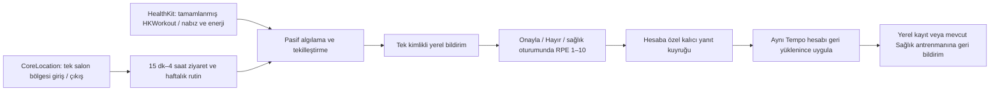

# Pasif antrenman ve salon ziyareti motoru

Antrenman sırasında telefona dokunulmaz. İlk kurulum ve oturum sonundaki onay kullanıcıya aittir.

## Sağlık yolu

- Mevcut HealthKit Background Delivery yetkisi kullanılır. HKWorkout gözlemcisi `.immediate`, diğer miktarlar `.hourly` ister. Bunlar teslim süresi garantisi değildir.
- Birincil kaynak tamamlanmış, kullanıcı tarafından elle girilmemiş HKWorkout'tur. Branş biliniyorsa nabız örüntüsü yerine bu kaynak esas alınır. Tanınmayan tür bir koşu veya kuvvet antrenmanı gibi sunulmaz.
- Ham veriyle öneri üretimi nabız yanında enerji/hareket desteği ister. Yeterli örnek olmadığında antrenman türü ve yük uydurulmaz.
- Yük: gözlenmiş süre × maksimum nabız yüzdesine göre Z1…Z5 ağırlıkları (1…5), ardından `ceil(10 × (1 − exp(−weightedMinutes/150)))`. En az %70 zaman kapsaması gerekir; örnekler arasındaki en çok 30 saniye hesaba katılır. Maksimum nabız verilmezse 190 bpm varsayımı açıkça belirtilir. Bu, Tempo v1 model tahminidir; klinik ölçek, RPE veya CNS ölçümü değildir.
- Pik/dinlenme örüntüsü direnç veya HIIT ile uyumlu olabilir; tek başına ağırlık antrenmanını kanıtlamaz. Telefon/saat farklı sporları nabızdan kesin olarak ayıramaz.
- Gerçek Sağlık kaydı sonradan gelirse bekleyen önerinin kimliği korunur. Aynı oturum için ikinci bildirim yığını veya ikinci toplam oluşturulmaz. Silinen Sağlık antrenmanına bağlı eski öneri kapatılır.

## Saatsiz salon yolu

- Aktiviteler → Otomatik algılama → Salonda pasif takip. Salon konumu salondayken bir kez seçilir; program adları isteğe bağlıdır.
- Tek 200 m bölge izlenir. Sürekli GPS, Bluetooth taraması, ses oturumu veya SSID izleyicisi açılmaz.
- Bölge olayları yaklaşık ziyaret süresidir. Kısa geçişler, dört saati aşan eksik çıkışlar, mükerrer ve sırası bozuk olaylar reddedilir. Rutin giriş gününe göre seçilir; gece yarısını aşan ziyaret ertesi günün programına çevrilmez.
- Wi‑Fi bilgisi ayrı entitlement ve konum koşulları ister; başka uygulamaların Bluetooth kulaklık kullanım geçmişi güvenilir bir arka plan ölçümü değildir. Bu opsiyonel sinyaller ürün içinde varmış gibi sunulmaz.
- Onaylanan kayıt `detected-gym` / kullanıcı onaylı salon ziyareti olarak etiketlenir. Nabız, kalori, mesafe, tur, tamamlanan set ve sensör onayı üretilmez. Daha sonra gelen gerçek Sağlık antrenmanı toplamda önceliklidir.
- Konum ve oturum dosyası yalnız cihazda, hesaba göre ayrılmış ve dosya korumalı tutulur; yedeklemeye dahil edilmez. Çıkış/hesap değişimi izlemeyi durdurur. Hesap silmede dosya temizlenir.

## Bildirim ve güvenli kayıt

- Evet/Hayır eylemleri ve sağlık oturumlarında sayısal RPE yanıtı kullanılır. iOS kilit ekranı on adet buton veya özel RPE kaydırıcısı sunmaz; `UNTextInputNotificationAction` ile 1–10 tam sayı alınır.
- Onay/RPE uygulamayı açar; işlemin aynı kullanıcıya ait olduğunun doğrulanması için cihaz kimlik doğrulaması gerekebilir. Yanıt önce cihazdaki hesaba özel kuyruğa yazılır; farklı Tempo hesabında uygulanmaz.
- RPE, mevcut 1–5 hissiyat alanına çevrilmez; 1–10 session RPE olarak saklanır. Gerçek Sağlık kaydı henüz uygulamaya gelmediyse yanlış arketip oluşturmak yerine eşitleme beklenir. Bu eşitleme için aynı kayıtta sonsuz otomatik yeniden deneme yapılmaz.
- HKWorkout zaten otomatik eşitlenir. Bildirim onayı ayrı bir kopya yaratmaz; Hayır yalnız bu öneriyi kapatır, Apple Sağlık kaydını silmez.

## Gerçek cihaz kabul kontrolü

Matematik, veri uyumluluğu, rutin, ziyaret ve tekilleştirme testleri CI'da çalışır. Aşağıdakiler fiziksel iPhone/Watch gerektirir; kaynak tür denetimi veya simülatör sonucu bunların yerine geçmez:

1. Sağlık + bildirim izinleri açıkken bir Watch antrenmanı bitir; eşitlemeden sonra tek bildirim ve tek aktivite olduğunu kontrol et. RPE `7` yanıtının aynı antrenmanın ayrıntısına işlendiğini doğrula.
2. Yoğun örnekler yokken sahte yük üretilmediğini kontrol et. Telefon dolaptayken ve saat yokken nabız/kalori alanı dolmamalı.
3. Salonda konumu kaydet, Her Zaman konum izni ver, en az 15 dakika sonra bölgeden çık. Hayır yeni yerel aktivite eklememeli; Evet yalnız kullanıcı onaylı ziyareti eklemeli.
4. Tekrarlanan giriş/çıkış, bildirim düğmesine tekrar basma, hesap değiştirme, yeniden başlatma/ilk kilit açılışı ve izin iptalini kontrol et.
5. Konum hizmetleri/Background App Refresh kapalı ve uygulama zorla sonlandırılmış durumlarda teslimin kesilebileceğini doğrula. iOS bildirim teslimini ve ekranın ele alınma anını uygulamaya garanti etmez.

## Apple belgeleri

- [HealthKit erişimi ve arka plan teslimi](https://developer.apple.com/documentation/xcode/configuring-healthkit-access)
- [Arka planda konum](https://developer.apple.com/documentation/corelocation/handling-location-updates-in-the-background)
- [Etkileşimli sayısal bildirim yanıtı](https://developer.apple.com/documentation/usernotifications/untextinputnotificationaction)
- [Wi‑Fi API sınırları](https://developer.apple.com/documentation/technotes/tn3111-ios-wifi-api-overview)
